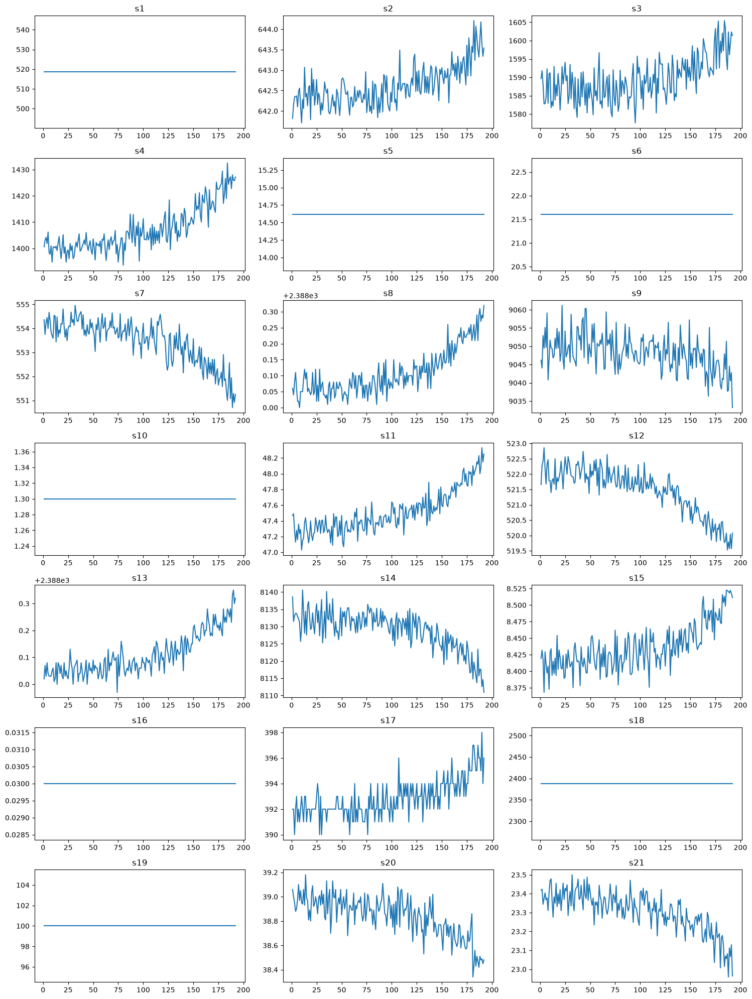
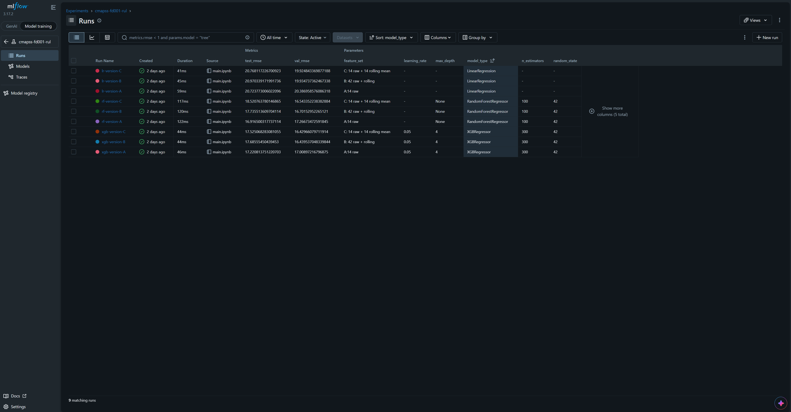

# NASA C-MAPSS RUL Prediction

Predicting the Remaining Useful Life (RUL) of turbofan engines from sensor data, using the `FD001` subset of NASA's C-MAPSS dataset.

Version 2 (rolling-window features, XGBoost, and MLflow tracking) is described in [Version 2](#version-2-rolling-windows-and-xgboost).

## Problem Statement
Unscheduled engine maintenance is expensive and disruptive when a failure isn't foreseen. This can trigger a chain reaction causing grounded aircraft, rushed part sourcing, and missed flight schedules.

In this project, with the help of engine sensor readings (temperatures, pressures, speeds) we can predict the Remaining Useful Life (RUL), i.e. the number of operational cycles left before an engine requires maintenance.
With the help of RUL, we can anticipate when a maintenance window is likely to occur and plan for that maintenance, like procuring parts and tools, making shop available to accept that engine.

## Dataset
- Source: NASA - https://data.nasa.gov/dataset/cmapss-jet-engine-simulated-data
- Reference: Saxena, Goebel, Simon, Eklund (2008), *Damage Propagation Modeling for Aircraft Engine Run-to-Failure Simulation*.
- Subset: `FD001` - chosen for its single operating condition and single fault mode.
    - `train_FD001.txt` contains sensor data recorded until failure.
    - `test_FD001.txt` contains sensor data of 100 engines, truncated before failure.
    - `RUL_FD001.txt` contains the true remaining cycles at each test engine's cutoff point.
- Structure: 100 engines, 26 raw columns. Narrowed to 19 input columns after preprocessing (14 sensor readings + `unit_number`, `time_cycle`, and `op_setting_1/2/3`), plus the derived `RUL` target (and a helper `max_cycle` column used to compute it). The operational settings were ultimately excluded from model training, since `FD001` runs under a single operating condition and they carry no useful variance.

## Methodology

### Version 1

**1. Target construction:**
In the training data, I derived RUL by taking the max cycle of each engine unit and subtracting the current cycle count from it. This gives the RUL of that engine at every cycle.

`RUL = max_cycle - time_cycle`

I also clipped the RUL values at 125. Without clipping, the model would be forced to distinguish between RUL values like 250 and 200 during a period where sensor readings show no meaningful difference, adding noise rather than learnable signal.

**2. EDA findings:**
I plotted all 21 sensors against cycle for engine 1 using Matplotlib subplots. From the plots I narrowed it down to 14 sensors, dropping the 7 that showed a flat trend: `s1, s5, s6, s10, s16, s18, s19`.
For the kept sensors (e.g. `s4`), the readings are stable at first, then show a trend with increasing variance as the engine nears failure.


*Plotted graphs showing all the sensor trends.*

**3. Preprocessing:**
- Using the sensor plots, I dropped the 7 sensors that had a flat trend from the DataFrame.
- Since sensors vary widely in scale and units (e.g. temperatures vs. pressures vs. speeds), I applied `StandardScaler` to normalize them.
- Before scaling, I split the training data into train/validation sets at the engine level (not row level; more on this below) to prevent leakage. `StandardScaler` was fit **only** on the training sensors, then used to transform (not re-fit) the validation and test sensors.

**4. Train/validation strategy:**
Splitting the data randomly by row would cause cycles from the same engine to leak across train and validation sets, since RUL for a given engine is highly correlated across adjacent cycles. Instead, I split at the engine level: the 100 unique `unit_number` values were split 80/20 using `train_test_split` with `random_state = 42` for reproducibility, then the corresponding engines' rows were pulled into `train_df` / `val_df` using the `.isin()` function.

**5. Models tried:**
First I set a naive baseline by predicting the mean RUL for every row, as a floor any real model should beat. Linear Regression came next as the baseline model: it is simple, fast, and easy to interpret. I then tried Random Forest, expecting it to handle non-linear patterns such as the growing sensor noise near failure.

I intentionally kept the hyperparameters at their defaults since this was a first end-to-end comparison, and tuning is a next step. Models were scored with RMSE, which is in the same units as RUL (cycles) and penalizes large errors more. I did not use the asymmetric scoring function from the original NASA paper.

**6. Why validate before touching the test set:**
The 20 held-out engines are complete run-to-failure trajectories the model never trained on, so I used them to compare models and catch problems. This paid off when re-running my notebook gave different validation numbers. Comparing the naive baseline error (65.7) with the standard deviation of the clipped RUL target (about 41.7) showed that the baseline error was implausibly large for a clipped target, and tracing it showed the clipping hadn't reached the training targets. After fixing it, validation RMSE dropped (Linear Regression 38.1 → 20.4). I kept the official test set untouched until the end and used it once, so the final score is an honest estimate on unseen engines.

## Results
### Version 1: Linear Regression and Random Forest

| Model | Validation RMSE | Test RMSE |
|-------|-----------------|-----------|
| Naive Baseline | 41.7 | n/a |
| Linear Regression | 20.4 | 20.8 |
| Random Forest | 17.3 | 16.8 |

Random Forest performed better than Linear Regression and reduced validation RMSE by about 58.6% relative to the naive baseline. I can also see that the validation and test scores are close, which suggests the models generalize well to unseen engines. These results show that Random Forest was a good choice for predicting RUL, with about 15% lower validation RMSE than Linear Regression.

These results are limited by the use of a single sub-dataset (`FD001`), scoring with plain RMSE rather than NASA's asymmetric scoring function, and a test score based on only 100 engines.

### Version 2: Rolling Windows and XGBoost
Compared to v1, I added an XGBoost model to test whether it beats Random Forest, and added rolling-window features to smooth out the sensor readings, so the model could see the mean and standard deviation over the previous 5 cycles. I compared three feature sets: A (14 raw sensors), B (raw plus rolling mean and std, 42 columns), and C (raw plus rolling mean, 28 columns). I used MLflow to track every run, so each result stays tied to the settings that produced it.

### Methodology (v2)
The pipeline is the same as v1: engine-level 80/20 split with `random_state = 42`, RUL clipped at 125, and `StandardScaler` fit on the training rows only. The changes as follows:

1. **Rolling-window features:** for each of the 14 kept sensors, I computed the mean and standard deviation over the previous 5 cycles (I did not tune the window size), which gives 28 new columns. They are computed per engine on the raw values, so a window never mixes two engines, and before scaling.

2. **First rows of each engine:** a 5-cycle window needs 5 readings, so the first 4 rows of every engine have no rolling values. I dropped them, which leaves 16,241 training rows and 3,990 validation rows (down from 16,561 and 4,070).

3. **Scaling:** the scaler was fit on all 42 feature columns of the training rows only (14 raw and 28 rolling), then used to transform the validation and test rows.

4. **Feature sets:** A uses the 14 raw sensors, B uses all 42 columns, and C uses 28 columns (raw plus rolling means). I built C after checking XGBoost's feature importance on B: rolling means took 9 of the top 10 places, no std column appeared, and C scored the same as B on validation.

5. **Models:** Linear Regression and Random Forest (default settings), and XGBoost (300 trees, learning rate 0.05, max depth 4). Models with a seed used `random_state = 42`.

6. **Test file:** I computed the rolling features on each test engine's full history first and kept only its last row afterwards. If I did the other way round, each engine has one row and every rolling value is empty. The test rows were scaled with the training scaler, and the true test RUL was clipped at 125 like the training targets.

7. **Tracking:** each of the nine runs (3 models × feature sets A, B, C) is logged in MLflow under the experiment `cmapss-fd001-rul`.



*MLflow UI showing the nine v2 runs (three models × feature sets A, B, C).*

RMSE in cycles (lower is better). Validation: 20 held-out training engines. Test: NASA’s 100 test engines, scored at each engine’s last cycle.

| Model              | Feature set  | Validation RMSE    | Test RMSE    |
|--------------------|--------------|--------------------|--------------|
| Naive Baseline     | n/a          | 41.77              | n/a          |
| Linear Regression  | A            | 20.39              | 20.72        |
| Linear Regression  | B            | 19.93              | 20.97        |
| Linear Regression  | C            | 19.92              | 20.77        |
| Random Forest      | A            | 17.27              | 16.92        |
| Random Forest      | B            | 16.70              | 17.74        |
| Random Forest      | C            | 16.54              | 18.52        |
| XGBoost            | A            | 17.01              | 17.22        |
| XGBoost            | B            | 16.44              | 17.69        |
| XGBoost            | C            | 16.43              | 17.53        |

- In this version, feature set A was trained on rows after the first 4 cycles of each engine were dropped (16,241 training and 3,990 validation rows), so the results slightly differ from the v1 table.
- The Naive Baseline (41.77) is scored on those same 3,990 validation rows.
- v2 values are shown to two decimals; the v1 table uses one decimal.

On validation, feature sets B and C improved on A by about 0.5 to 0.7 cycles for every model. On test, they did not: B and C were slightly worse than A for all three models, most clearly for Random Forest (16.92 with A, 18.52 with C). The best model on validation (XGBoost with C, 16.43) was therefore not the best on test (Random Forest with A, 16.92).

Since validation scores come from 20 engines and test scores from only 100 points, so differences of around a cycle can be noise. The two also measure different things: validation covers every cycle of the held-out engines, test only each engine’s last observed cycle. All results are on `FD001`, which has a single operating condition, and I haven’t tested `FD002` to `FD004`. So the small validation gain from rolling features did not hold on test, and on `FD001` I can’t claim that it helps.

## Lessons Learned

1. Initially, I did the scaler transformation before splitting the data into train/validation sets. This computed the mean and std using all 100 engines, which leaked information from the validation engines into training. I learned to scale only after splitting into train/val or train/test. I now fit the scaler on the training data only, then use `.transform()` (not `.fit_transform()`) on validation and test.

2. During the first run of the full code, I didn't realize that I had left out the RUL clip from the training targets, so I trained my model on unclipped RUL. This made my results look plausible even though they were wrong. I noticed the problem when re-running the notebook changed my results. Comparing the naive baseline error (65.7) with the target's std (41.7) showed the training targets were unclipped. With this I learned to sanity-check a model against a naive baseline and the target's own spread, and to make sure the same convention applies to the training target, the validation target, and the test ground truth.
   
3. After adding rolling features, I saw XGBoost's validation RMSE improved slightly, from 17.01 cycles (feature set A) to 16.43 cycles (feature set C), but on the test set it rose from 17.22 to 17.53. Since the validation scores came from only 20 engines, a gain of about 0.6 cycles was too little evidence to claim a real improvement. I report validation and test results side by side, and I don’t claim a small validation gain that the test set doesn’t confirm.

## How to Run
1. Clone the repo:
   ```bash
   git clone https://github.com/sohail-raheman/cmapss-rul-prediction.git
   cd cmapss-rul-prediction
   ```
2. Dependencies: Python 3.13 (tested), numpy, pandas, matplotlib, seaborn, scikit-learn v1.4 or newer, xgboost, mlflow, and Jupyter notebook
   ```bash
   pip install numpy pandas matplotlib seaborn "scikit-learn>=1.4" xgboost mlflow jupyter
   ```
3. This repo doesn't contain the data. Download it from https://data.nasa.gov/dataset/cmapss-jet-engine-simulated-data and place `train_FD001.txt`, `test_FD001.txt`, and `RUL_FD001.txt` in a `data/` folder in the repo root (next to `v1/` and `v2/`, not inside them).
4. Run a version:
   - **v1:** open `v1/main.ipynb` in VS Code or Jupyter and use Restart and Run All.
   - **v2:** open `v2/main.ipynb` and use Restart and Run All. This also logs the runs to a local `v2/mlflow.db`.

   The notebooks read the data from `../data/`, so they must run with their own folder as the working directory, which is the default when you open the notebook file.
5. View the v2 MLflow runs (after running the v2 notebook):
   ```bash
   cd v2
   mlflow ui --backend-store-uri sqlite:///mlflow.db
   ```
   Then open http://127.0.0.1:5000 in your browser. The runs are under the experiment `cmapss-fd001-rul`.